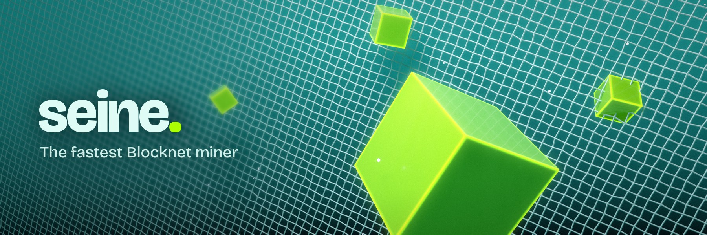
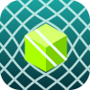
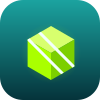
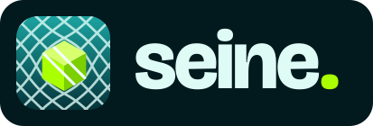

# seine brand

A seine is a fishing net. Seine the miner pulls blocks out of the Blocknet, so the
identity shows exactly that: a diamond-mesh net stretched across deep teal water,
with a glowing lime block caught in it or breaking through. Lime is shared with
Blocknet; the teal water is seine's own.

Assets live in [`docs/assets/brand/`](assets/brand).

## Key art

  

Two compositions, rendered in Blender:

| Composition | Use |
|---|---|
| **Breaking through**: one block pushing through the mesh, cells stretched around it | Avatar, hero image, anything square or small |
| **Diagonal haul**: the net running across the frame with blocks lodged in it | README banner, social card, anything wide with room for type |

Files: `banner.jpg` (README, 1800×600, wordmark baked in), `social-card.jpg` (GitHub
and social link previews, 1280×640), `avatar.png` (512, crop to a circle on X/Discord).

## Icon

  
  

The flat icon redraws the key art: an isometric lime block caught in the net on a teal
tile. `icon.svg` is for 48 px and up; `icon-simple.svg` drops the net for favicons
(`icon-32.png`, `icon-16.png`). `icon-180.png` is the Apple touch icon.

## Lockup

  

Icon, then the `seine.` wordmark in Bricolage Grotesque ExtraBold, always lowercase,
with a lime full stop. Use `lockup-light.svg` / `lockup-dark.svg` on transparent
grounds and `lockup-card.svg` where the ground is unknown.

## Colour

| Token | Hex | Use |
|---|---|---|
| Abyss | `#021A1E` | Deepest ground; lockup card, chart surroundings. |
| Deep | `#063B44` | Dark teal ground; type on light backgrounds; badge labels. |
| Teal | `#1BA3A0` | The water. Gradients from Teal down to Abyss. |
| Foam | `#DFFBF6` | The net, headings and text on dark grounds. |
| Lime | `#AAFF00` | The catch. Blocks, the wordmark's full stop, highlights. Shared with Blocknet. |
| Lime (on light) | `#4E9A00` | Lime's stand-in on white grounds (3.5:1). |

Lime is the accent: one caught thing per composition, never a large field. In renders,
keep block emission low enough that lime stays `#AAFF00` rather than clipping to yellow.

### Charts

Charts sit on a `#042329` card with Foam text (`#8CC9C2` secondary, `#6FA9A2` axes,
`#0E3B40` gridlines). Hardware families use these colours, validated against that card
for colour-blind separation and 3:1 contrast, and every bar is also named in text:

| Family | Hex |
|---|---|
| AMD | `#E5603E` |
| Intel | `#2F86E8` |
| Arm | `#BD8209` |
| Apple | `#9473EE` |
| NVIDIA | `#3F9C5A` |

## Type

- **Bricolage Grotesque** (ExtraBold for the wordmark and titles, Medium for taglines).
- **IBM Plex Sans / Plex Mono** for chart labels, numbers and data.

All are OFL-licensed and safe for public use. Don't use the Blocknet kit's SF Mono in
seine assets; its licence only covers local mock-ups.

## Regenerating

1. Render with Blender: `scripts/brand/net_scene.py --style teal --variant C|D` (the
   framing flags used for each asset are listed in `scripts/brand/README.md`).
2. Grade: `python3 scripts/brand/grade.py in.png out.png <light x> <light y> '#C8FFF4'`.
3. Build: `python3 scripts/brand/assets.py --font … --font-text … --hero … --banner … --avatar … --social …`.
4. Charts: `python3 scripts/readme_charts.py --font-dir <dir with Plex and Bricolage>`.

## Voice

Confident and specific. Lead with a measured number, name the hardware, link the
evidence: "44.7 H/s on an EPYC 9R45 at 24 workers", not "up to 2× faster". Leave
privacy claims to Blocknet's own messaging; seine talks about mining.
