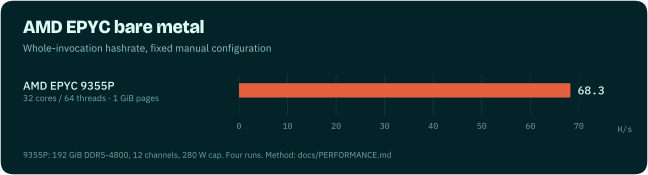
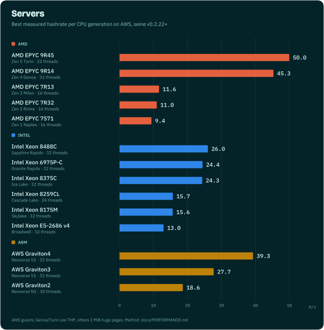
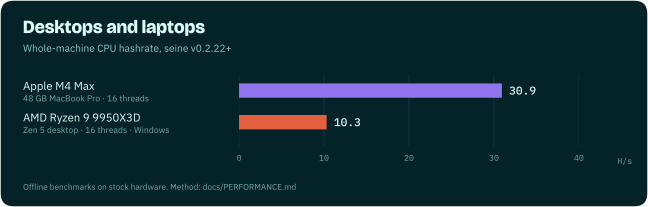

# Performance

Blocknet's proof of work is Argon2id with a 2 GiB arena per hash: it is
memory-hard, so hashrate depends as much on memory bandwidth and latency as on core
count. Seine ships hand-tuned kernels for each instruction set and picks the
fastest one for your machine while it mines.

Every number on this page is a measured result from repeated runs. Hash accounting
and timing scopes are documented with each measurement below. Evidence
for each row is linked, and chart data lives in
[`assets/charts/benchmarks.json`](assets/charts/benchmarks.json).

- [AMD EPYC 9375F bare metal](#amd-epyc-9375f-bare-metal)
- [AMD EPYC 9554P bare metal](#amd-epyc-9554p-bare-metal)
- [AMD EPYC 9355P bare metal](#amd-epyc-9355p-bare-metal)
- [Automatic AMD tuning](#automatic-amd-tuning)
- [Cloud servers](#cloud-servers)
- [Desktops and laptops](#desktops-and-laptops)
- [Kernel comparisons](#kernel-comparisons)
- [Kernel coverage by CPU generation](#kernel-coverage-by-cpu-generation)
- [Benchmark your own machine](#benchmark-your-own-machine)
- [Method and limits](#method-and-limits)

A thread here is one hashing thread with its own 2 GiB arena, the same number you set
with `--threads` or see as "Threads" on the dashboard.

## AMD EPYC 9375F bare metal

**85.10 H/s** on a complete 32-core/64-thread Zen 5 Turin socket, with
384 GiB across twelve DDR5-6000 memory channels and native Linux.
The official v0.2.39 release used 64 fixed mining threads,
`avx512-256-stream` and explicit 1 GiB huge pages (128 GiB of hash arenas).

Three fresh 120-second invocations measured **85.18, 85.14 and 84.97 H/s**.
The rate counts all completed hashes over the entire process invocation,
including allocation, work, fences and shutdown. A separate 60-second screen
at 16, 32, 48 and 64 workers selected 64 before confirmation. All worker arenas
had verified 1 GiB backing, with zero allocation failures, and all 21 independent
reference-parity cases passed. Power settings were unchanged; power was not
measured. This is a manual configuration, not an automatic-startup or pool-credited
rate, and the comparison with another CPU is not a software percentage gain.
[Selection, reports and reproduction](../experiments/9375f-headline-20261027/README.md).

## AMD EPYC 9554P bare metal

**75.04 H/s** on a complete 64-core/128-thread Zen 4 Genoa socket, with
384 GiB of DDR5-4800 memory across twelve channels and native Linux.
The official v0.2.39 release used a **fixed manual configuration**: 64 mining
threads, `avx512-256-stream`, and explicit 1 GiB huge pages (128 GiB of hash
arenas). Power settings were left unchanged; package power was not measured.

Three fresh 120-second invocations measured **75.03, 75.05 and 75.02 H/s**.
These rates count all completed hashes and divide by whole-process elapsed time,
including startup, allocation, work, fences and shutdown. A separate 60-second
screen of 32, 64, 96 and 128 mining threads selected 64 before those confirmations.
All 21 independent 1 GiB kernel parity cases passed.

[Reports, selection and reproduction](../experiments/headline-20261027/README.md).
This is a measured configuration on this socket, not an automatic-tuning result
or a same-hardware percentage gain over the previous cloud-server chart entry.

## AMD EPYC 9355P bare metal



A complete 32-core/64-thread Turin socket with 192 GiB of memory across twelve
DDR5-4800 channels, running native Linux. The official v0.2.39 release measured
**77.07 H/s** with 64 fixed mining threads, `avx512-256-stream` and explicit
1 GiB huge pages. Power settings were left unchanged; power was not measured.

The original v0.2.24 benchmark executable and v0.2.39 ran in baseline/current/
current/baseline order, with one fresh 120-second invocation each. Current runs
measured **77.13 and 77.02 H/s**; the paired baseline averaged **66.54 H/s**,
a **15.83%** geometric paired improvement on this machine. Rates include all
completed hashes and whole-process elapsed time. Both executables passed all
21 independent 1 GiB kernel parity cases. This measures a manual configuration;
it does not measure automatic cold-start tuning or pool-credited work.
[Rebenchmark evidence](../experiments/headline-20261027/README.md#epyc-9355p-rebenchmark).

### Earlier page-size and power-cap comparisons

These separate historical comparisons used four fresh 120-second invocations
per configuration, including startup and shutdown. Each has its own paired
control; their power measurements do not apply to the v0.2.39 result above.

| Configuration | H/s | Measured CPU-package W | CPU-package J/hash | Evidence |
|---|---:|---:|---:|---|
| 64 threads, 1 GiB pages, 280 W cap | 68.26 | 251.62 | 3.686 | [Page comparison](../experiments/amd-page-size-20261025/RESULTS.md) |
| 64 threads, 2 MiB pages, 240 W cap | 66.56 | 213.03 | 3.200 | [Power-cap comparison](../experiments/cherry-epyc-energy-20261025/RESULTS.md) |

The 1 GiB page comparison improved hashrate **0.91%** over its 2 MiB control.
The separate 240 W cap comparison reduced package energy per hash **13.41%**
while retaining **98.42%** of its 280 W control's hashrate. Package energy covers
the CPU package; RAM and wall power were not measured. A cap is a configured
limit, distinct from measured watts. The combined 1 GiB/240 W configuration has
not been measured, so these gains are not combined.

**Power capping is opt-in.** Seine's default tuning optimizes hashrate and does
not apply the measured 240 W cap. The efficiency configuration is a manual
choice for operators who prefer lower package power over peak throughput.

## Automatic AMD tuning

The following improvements shipped in v0.2.25. These runs use automatic thread
and kernel selection with the
balanced profile and prepared 2 MiB huge pages. Rates include discovery/startup
and shutdown; cached restarts use each build's own previously learned settings.

| Machine and phase | Before H/s | After H/s | Paired gain | Repetitions |
|---|---:|---:|---:|---|
| EPYC 9355P, cold start | 61.43 | 65.92 | +7.32% | Four 20-minute pairs |
| EPYC 9355P, cached restart | 56.73 | 65.44 | +15.32% | Four 3-minute pairs |
| EPYC 9R14, c7a.8xlarge, cold start | 26.90 | 27.67 | +2.85% | Two 15-minute pairs |
| EPYC 9R14, c7a.8xlarge, cached restart | 28.06 | 30.30 | +7.99% | Two 3-minute pairs |

The Turin comparison measures shorter high-count kernel samples against the
already accepted challenger ordering. Genoa measures streaming eligibility with
a 24-thread ceiling in a 32-vCPU VM. These are productive-work comparisons, not
fixed-kernel speedups or measurements of fully converged throughput.
[Turin evidence](../experiments/amd-trial-windows-20261025/RESULTS.md) ·
[Genoa evidence](../experiments/genoa-streaming-20261025/RESULTS.md) ·
[All 33 campaign records](../experiments/amd-campaign-20261025/benchmark-index.json).

## Cloud servers



| CPU | Generation | Instance | Threads | Kernel | H/s |
|---|---|---|---:|---|---:|
| AMD EPYC 9R45 | Zen 5 Turin | m8a.8xlarge | 32 | streaming ring 64 / depth 4 | 50.47 |
| AMD EPYC 9R14 | Zen 4 Genoa | m7a.8xlarge | 32 | streaming ring 8 / depth 2 | 45.30 |
| AMD EPYC 7R13 | Zen 3 Milan | c6a.8xlarge | 16 | AVX2 streaming | 18.09 |
| AMD EPYC 7R32 | Zen 2 Rome | c5a.8xlarge | 16 | AVX2 streaming | 17.42 |
| AMD EPYC 7571 | Zen 1 Naples | m5a.8xlarge | 16 | AVX2 | 9.38 |
| Intel Xeon 8488C | Sapphire Rapids | m7i.8xlarge | 32 | streaming | 26.00 |
| Intel Xeon 6975P-C | Granite Rapids | m8i.8xlarge | 32 | streaming | 24.42 |
| Intel Xeon 8375C | Ice Lake | m6i.8xlarge | 32 | streaming | 24.32 |
| Intel Xeon 8259CL | Cascade Lake | m5n.8xlarge | 24 | streaming | 15.69 |
| Intel Xeon 8175M | Skylake | m5.8xlarge | 32 | streaming | 15.64 |
| Intel Xeon E5-2686 v4 | Broadwell | r4.8xlarge | 32 | AVX2 | 12.95 |
| AWS Graviton4 | Neoverse V2 | m8g.8xlarge | 32 | NEON + SHA3 | 39.29 |
| AWS Graviton3 | Neoverse V1 | m7g.8xlarge | 32 | NEON + SHA3 | 27.70 |
| AWS Graviton2 | Neoverse N1 | m6g.8xlarge | 30 | NEON | 18.63 |

The EPYC 9R45 row uses 32 threads and full transparent huge-page backing.
Three fresh alternating confirmation pairs measured **50.47 H/s versus 50.29 H/s**
with the previous prefetch depth: **+0.35%**, with a paired 95% bootstrap interval
of +0.22% to +0.43%. All 13,302 timed hashes across screening and confirmation
verified independently. This fixed-kernel measurement excludes allocation,
warmup and teardown; startup, pool throughput and energy are separate results.
[Turin confirmation, frozen sources and raw reports](../experiments/turin-prefetch-20261026/README.md).

The EPYC 9R14 row uses 32 threads and full transparent huge-page backing. Three
alternating 30-second confirmation pairs measured **45.30 H/s versus 44.18 H/s**
with the previous fence policy: **+2.55%**, with a paired 95% bootstrap interval
of +2.53% to +2.58%. All 11,870 timed hashes across screening and confirmation
were independently verified. This fixed-kernel research driver excludes allocation,
warmup and teardown and includes completed in-flight hashes; its confirmed kernel
change ships in v0.2.32. Cold-start, pool throughput and energy results are separate.
[Genoa confirmation, frozen source and raw reports](../experiments/genoa-fences-20261026/README.md).
The earlier ring-size improvement remains documented in the
[previous confirmation](../experiments/genoa-ring-20261026/README.md).

On native Windows Server 2025, the same EPYC 9R14 instance class measured
**33.70 H/s versus 32.84 H/s** with ordinary pages at 32 threads: **+2.61%**
from the Windows fence improvement in v0.2.33. Three fresh alternating
30-second pairs gave a paired 95% interval of +2.19% to +2.99%; all 8,936
timed hashes across screening and confirmation verified independently.
[Windows method and raw reports](../experiments/genoa-windows-fences-20261026/README.md).

The EPYC 7R32 row uses 16 fixed threads, full transparent huge-page
backing and the AVX2 streaming kernel. Its value averages two 20-second
candidate runs in an alternating baseline/candidate/candidate/baseline sequence,
with one warmup round per run. These are the backend report's `avg_hps`:
counted hashes divided by elapsed time including the final fence; hashes
completed late are excluded from the numerator. Allocation and warmup are
outside the timed interval. These settings shipped by v0.2.39.
[Reports and calculation](../experiments/chart-refresh-20261027/README.md).

The EPYC 7R13 row uses the official v0.2.39 release at 16 fixed threads with
full THP backing. Two 120-second measured rounds, each after a 120-second warmup,
averaged **18.09 H/s**, versus **12.09 H/s** for v0.2.29 in a same-instance
baseline/current/current/baseline comparison: **+49.55%** geometric paired gain.
Rates count hashes within the measured window and include fence time; allocation,
warmup and shutdown are excluded. This compares the versions and selected
kernels together. [Method and all four reports](../experiments/zen3-release-20261027/README.md).

Other rows use 32-vCPU AWS instances with explicit 2 MiB huge pages, swept
across kernels and thread counts, with four timed runs at the winning setting.
Their raw results and method remain in the
[readme-hardware campaign](../experiments/readme-hardware-20261025/README.md).

## Desktops and laptops



| Machine | Configuration | H/s | Evidence |
|---|---|---:|---|
| Apple M4 Max, 48 GB | 16 threads, `auto` affinity, CPU only | 30.94 | 2026-07-10 Mac sweep ([guide](guides/apple-silicon.md)) |
| Apple M4 Max, 48 GB | 14 threads, `pcore-only` (balanced) | 29.26 | three paired runs, 2026-07-10 |
| AMD Ryzen 9 9950X3D | 16 threads, native Windows, regular pages, streaming kernel | 10.31 | four alternating pairs, [high-end streaming](../experiments/high-end-streaming-20261025/RESULTS.md) |

NVIDIA GPUs mine at the same time as the CPU and their rates add up; see the
[NVIDIA guide](guides/nvidia.md).

## Kernel comparisons

Same machine, same thread count and page backing, alternating runs of two kernels.
Seine picks between them automatically while it mines:

| Machine | Change | Before | After | Gain |
|---|---|---:|---:|---:|
| AWS Graviton4 (Neoverse V2), 16 threads | NEON → runtime SHA3 + prefetch | 13.80 | 21.50 | +56% |
| AMD Ryzen 9 9950X3D, 16 threads | 256-bit AVX-512 → streaming | 7.07 | 10.31 | +46% |
| AWS Graviton3 (Neoverse V1), 16 threads | NEON → runtime SHA3 + prefetch | 12.52 | 18.17 | +45% |
| AMD EPYC 9R45 (Zen 5 Turin), 24 threads | AVX2 → streaming | 34.47 | 44.74 | +30% |
| AMD EPYC 9R14 (Zen 4 Genoa), 24 threads | AVX2 → streaming | 28.07 | 35.70 | +27% |
| AWS Graviton2 (Neoverse N1), 16 threads | portable NEON tuning | 10.61 | 11.05 | +4% |

Evidence: [CPU campaign results](../experiments/cpu-campaign-20261024/RESULTS.md),
[EPYC integration](../experiments/epyc-investigation/INTEGRATED_VALIDATION.md),
[high-end streaming](../experiments/high-end-streaming-20261025/RESULTS.md).

## Kernel coverage by CPU generation

Seine's x86 builds carry scalar, AVX2 and AVX-512 kernels plus a streaming-store
variant, and Arm builds carry NEON with a SHA3 fast path. Automatic tuning compares
them while mining and only switches after two confirmed gains. Recent paired
measurements on real hardware, one generation per row:

**AMD EPYC**

| Generation | Tested CPU | Result |
|---|---|---|
| Zen 1 (Naples) | EPYC 7571 | Paired-column AVX2 kernel: +11–16% |
| Zen 2 (Rome) | EPYC 7R32 | Paired-column AVX2 kernel: +10–34% |
| Zen 3 (Milan) | EPYC 7R13 | Paired-column AVX2 kernel: +3–14% |
| Zen 4 (Genoa) | EPYC 9R14 | Streaming kernel: +27% at 24 threads |
| Zen 5 (Turin) | EPYC 9R45 | Streaming kernel: +30% at 24 threads; AVX-512 +15–20% at one thread |

**Intel Xeon**

| Generation | Tested CPU | Result |
|---|---|---|
| Broadwell | Xeon E5-2686 v4 | Paired-column AVX2 kernel: +11–12% |
| Cascade Lake | Xeon 8275CL | AVX-512 over AVX2: +17–19% |
| Ice Lake | Xeon 8375C | AVX-512 over AVX2: +21–29% |
| Sapphire Rapids | Xeon 8488C | AVX-512 over AVX2: +7–9% |
| Granite Rapids | Xeon 6975P-C | AVX-512 over AVX2: +6–7% |

**Arm**

| Generation | Tested CPU | Result |
|---|---|---|
| Neoverse N1 | Graviton2 | Portable NEON: +4% |
| Neoverse V1 | Graviton3 | SHA3 + prefetch: +45% |
| Neoverse V2 | Graviton4 | SHA3 + prefetch: +56% |

Ranges span one to four threads with regular and huge pages. Full tables, thread
counts and confidence intervals are in the
[architecture matrix](../experiments/cpu-architecture-20261024/README.md).

## Benchmark your own machine

Offline benchmarks need no daemon or pool:

```bash
# Whole-machine CPU benchmark with default settings
./seine --bench --bench-kind backend --backend cpu --bench-secs 20 --bench-rounds 3

# Compare kernels at a fixed thread count
./seine --bench --bench-kind backend --backend cpu --threads 8 \
  --disable-cpu-autotune-threads --bench-cpu-kernel avx2 --bench-secs 20 --bench-rounds 3
```

`--bench-cpu-kernel` accepts `scalar`, `avx2`, `avx512`, `avx512-256`,
`avx512-256-stream`, `neon` and `neon-sha3`, subject to CPU support. For statistically paired
A/B comparisons, use the [benchmark lab](benchmarks.md).

## Method and limits

- Cloud results are AWS EC2 guests. A VM exposes a slice of a physical host; memory
  bandwidth share, SMT exposure and topology vary by instance type. They describe
  that guest, not a whole bare-metal socket.
- Desktop results are single machines in a stated configuration. Your RAM speed,
  cooling and background load will move the numbers.
- Huge pages, thread count and CPU placement all change which kernel wins, which is
  why seine measures on your machine instead of hard-coding a choice. See the
  [hardware guides](../README.md#get-the-most-from-your-hardware).
- Multi-socket NUMA servers have not been benchmarked yet.

Tuning history: [CPU optimization log](../CPU_OPTIMIZATION_LOG.md) ·
[NVIDIA optimization log](../NVIDIA_OPTIMIZATION_LOG.md).
