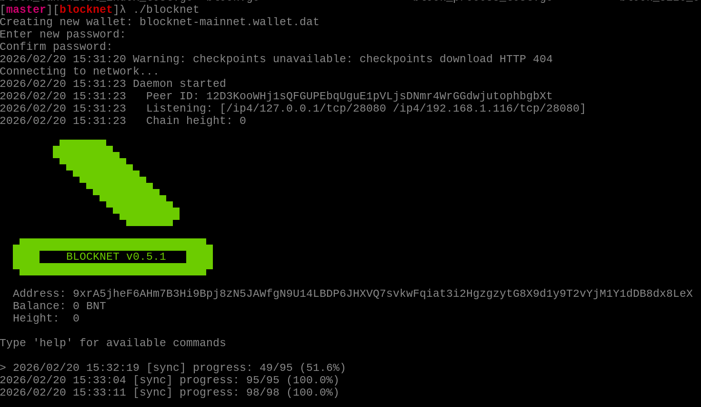

# Solo mining with a Blocknet daemon

Pool mining is the default and the easiest way to get regular payouts. Solo
(daemon) mining submits blocks directly to your own Blocknet node.

## 1. Install and sync Blocknet

Use the wrapper-managed flow:

```bash
blocknet install latest
blocknet start mainnet
```

This creates or reuses the managed config under `~/.config/bnt`, starts the core,
and writes the API cookie under `~/.config/bnt/data/mainnet/api.cookie` unless you
override `data_dir` in the Blocknet config.

You will be prompted to set a wallet password if needed. Once the daemon starts,
wait for it to fully sync; the `[sync] progress` messages reach 100%:



## 2. Start Seine in daemon mode

Wrapper-managed installs need no daemon arguments:

```bash
./seine --mode daemon
```

For a custom core layout, point Seine at the API and cookie:

```bash
./seine --mode daemon --api-url http://127.0.0.1:8332 --cookie /path/to/api.cookie
```

## Wallet

Password sources are checked in this order: `--wallet-password`,
`--wallet-password-file`, the `SEINE_WALLET_PASSWORD` environment variable, then an
interactive prompt.

```bash
./seine --mode daemon --wallet-password-file /path/to/wallet.pass
```

When `--address` matches the daemon wallet address, the dashboard shows wallet
pending/unlocked balances. If it differs, balance fields show `---` for the
override address.

In pool mode, Seine also checks for a local daemon when daemon auth is available;
if one responds, the wallet panel shows the local wallet balance next to the pool
balance.

## Reliability

If the daemon has forgotten your block template (for example after a restart),
Seine automatically resubmits the full solved block, so a found block is not lost.
