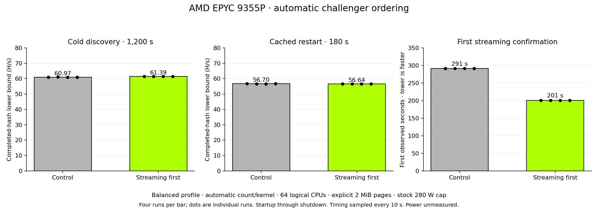

# Turin automatic challenger ordering

**Accepted: try streaming before AVX2 on AuthenticAMD family 1Ah/model 02h.**
The initial kernel and both confirmation cycles remain unchanged. Every
supported challenger is still tested; the change reduces discovery delay.

Tested on 2026-10-25: bare-metal AMD EPYC 9355P, 32 cores/64 hardware threads,
one socket/NUMA node, 192 GiB across twelve populated DDR5-4800 channels.
Both builds used the default balanced profile, automatic worker/kernel
selection and affinity, explicitly reserved 2 MiB HugeTLB and the stock 280 W
package cap. No worker minimum, maximum or fixed kernel was specified.

| Productive phase | Control H/s | Streaming first H/s | Paired geometric change | Descriptive 95% interval |
|---|---:|---:|---:|---:|
| Cold discovery, 1,200 s × 4 | 60.974 | 61.391 | **+0.685%** | +0.603% to +0.751% |
| Own-cache restart, 180 s × 4 | 56.696 | 56.644 | −0.092% | −0.241% to +0.057% |

Rates are total logged completed hashes divided by total service-start-request
through stopped-service seconds. They include discovery, startup and shutdown;
final unlogged hashes are omitted. The intervals describe four paired runs in
one host session, not a hardware-population confidence interval. Cold and cached
windows have different durations and must remain separate series.

All eight cold legs started with 32 workers and confirmed streaming after two
A/B/A cycles. Ten-second snapshots first observed confirmation at about 291 s
for the control and 201 s for the candidate, roughly **90 seconds earlier**.
All cached restarts began at their own previous worker count and logged
streaming-cache restoration about 37 seconds into the run. Controls selected
47/48/48/48 workers; candidates selected 48/47/47/47. This does not establish
full search convergence or the optimal steady-state count.

The three fixed-streaming build-control pairs were effectively unchanged:
**−0.0048%**, descriptive interval −0.0678% to +0.0866%. No build-effect correction
was applied. All 21 full-size reference transitions passed, with dirty-arena
reuse and guard checks. Productive runs had no swap, OOM or quarantine.

## Resource validation and preserved fixture failure

The original controller completed every productive window but its final resource
fixture failed: it changed the worker budget without producing actual reclaim
pressure (`memory.events.high` and memory PSI stayed zero). That original
outcome remains **FAILED** in the archive.

A separately frozen, fully repeated resource fixture used the identical
candidate executable and added bounded allocation inside the owned cgroup.
It passed all phases, producing 4,190 memory-high events and 32.094 seconds of
aggregate memory-pressure stall time, with no OOM or swap. Workers parked at
zero and resumed; CPU contention, constrained restart and explicit opt-out
passed. The remembered count of 3 survived the constrained restart, which
recovered from 1 to 2 workers with at least 4 GiB of anonymous backing during
the observed 210 seconds. Recovery to all 3 was not demonstrated.

The allocation helper required the supervisor's bounded SIGKILL after the
pressure phase (exit −9); OOM counters remained zero. Both controllers restored
page pools and swap. The strict combined audit binds the original failure and
supplement to their archive hashes, helper patch and identical candidate hash.
It never relabels the original archive as complete.

## Reproduction and scope

[Frozen builds](frozen-builds.json) and the reconstructable runtime patch identify
the measured code. The [adoption review](adoption-review.json) binds acceptance
to both evidence sets and all comparisons. [Results](results.json) retain
per-run trajectories and resource phase summaries; [JSON](benchmark-records.json)
and [CSV](benchmark-records.csv) provide four reusable graph records with source,
binary, settings, raw numerators, durations and variability.

Promotion logs retain rounded rates. Conservative rounding/quantization bounds
pass both confirmation cycles in all cold legs. The final winner cache retains
the later losing challenger comparison rather than the complete earlier raw
promotion samples; this review is not an exact replay of raw promotion inputs.
The ordering-specific unit test also verifies both confirmations and the later
AVX2 trial before caching.

Power was **unmeasured** in these productive runs. The 280 W value is a cap,
not measured package watts; do not combine these rates with the separate energy
dataset to infer efficiency. The measured frozen binaries remain distinct from
the later integration build.

The original archive verified 281 manifest entries; the supplement verified 32.
Archive and manifest SHA-256 values are in `results.json`. Raw operational data
remains private. Integration passed 563 CPU-only workspace tests (six existing
hardware/resource tests ignored), scoped Rust 1.93 formatting and 12 evidence,
export and reclaim-helper tests.
