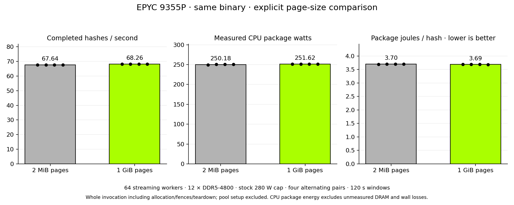

# EPYC 9355P explicit page-size comparison

**1 GiB pages improved whole-invocation throughput by 0.908% and reduced CPU
package joules per hash by 0.330%** in four alternating pairs on this host.
The explicit configuration passed the preregistered throughput and efficiency
gates. No automatic page policy changed.

Hardware: bare-metal AMD EPYC 9355P, 32 cores/64 hardware threads, one socket/NUMA
node, 192 GiB across twelve populated DDR5-4800 channels. Both sides used the
same frozen executable, 64 streaming workers, automatic affinity, disabled
worker autotuning and the stock 280 W package cap. Only explicit page size varied.

| Explicit backing | Completed H/s | Measured package W | Package J/hash |
|---|---:|---:|---:|
| 2 MiB HugeTLB | 67.642 | 250.180 | 3.6986 |
| 1 GiB HugeTLB | **68.256** | 251.618 | **3.6864** |

These are ratios of summed completed hashes, package joules and invocation
seconds across four runs per mode. Each run included one 120-second end-to-end
round with no uncounted warmup. The observed interval includes startup, arena
mapping, hashing, fences and teardown; pool reservation and the ten-second
settling interval occurred outside it. Package energy excludes separately
unmeasured DRAM and wall losses.

The paired geometric H/s gain was **+0.908%**, with a descriptive 95% interval
of **+0.859% to +0.966%**. Package J/hash changed **−0.330%**, interval
**−0.455% to −0.168%**. All four pairs improved both metrics. Package watts
increased **0.575%**: this configuration did more work per package joule, but
did not lower package power. Four pairs in one host session do not establish
architecture-wide uncertainty, and the small efficiency change merits another
host/session before broad hardware claims.

The host dynamically reserved all 128 required one-GiB pages. The verifier
confirmed a real 1 GiB mapping and passed all 21 full-size dirty-reuse and guard
transitions against RustCrypto. Every measured leg verified all 64 worker arenas
with the requested backing, without fallback. Before each leg, both pools were
emptied and only the required pool was reserved. No swap, OOM or allocation
failure appeared, and both pools returned to zero with the original unused swap
restored after the experiment.

## Reproduction and scope

This is a manual operating configuration for a qualified Linux host. The existing
`--cpu-page-mode large-1g` option requires successful 1 GiB HugeTLB allocation;
the result does not justify changing the default or assuming every machine can
reserve the needed pool. Do not multiply this gain by the separate 240 W-cap
result: the combined configuration has not been measured in this experiment.

The executable SHA-256 is
`a4d3bd3b1091102b9d50b8d5c80aed057e8d30534ddcfee742b1d69ec137f6dc`,
prepared at `28191b798b8dc18fdf6ebcaf44fd549b35264870` with the unchanged
ring-64 runtime from `d92abe5872bf215a2f001af4e3891c4afa1a3fcc`. The
[ring build manifest](../amd-ring-locality-20261025/frozen-builds.json) retains
its build settings and source reconstruction. Both page modes use that exact
executable; later source changes are not represented as measured builds.

[Results](results.json) retain all paired metrics, sample checksums, allocation
feasibility, manifest and archive hashes. [JSON](benchmark-records.json) and
[CSV](benchmark-records.csv) provide two reusable graph records with raw
numerators/denominators, configuration and variability. All **104 archive
manifest entries verified** before the next native experiment. Raw operational
data remains private.

The page-size comparator, admission and export checks passed 14 tests. The
1 GiB verifier passed native parity on the qualified host; unavailable-page
behavior was also checked locally and fails without falling back.
