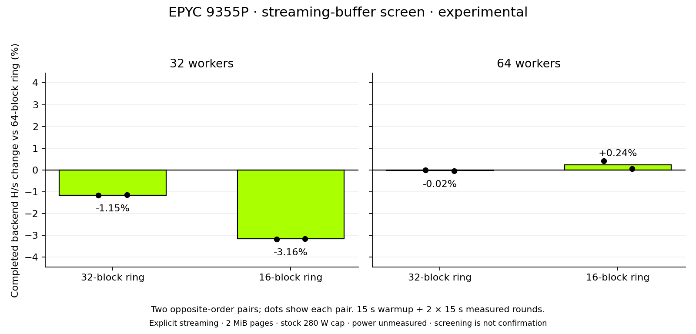

# Streaming-buffer locality on EPYC 9355P

**Complete: retain the shipping 64-block buffer.** The smaller buffer did not
meet the predeclared adoption threshold in fresh confirmation.

The experiment tested whether a smaller recent-block buffer helps the streaming
kernel fit the 48 KiB L1 data cache on this Turin host. A smaller buffer also
requires more fences before reading older blocks from the arena. The result
depends on that tradeoff; cache size alone does not predict a gain.

Hardware: bare-metal EPYC 9355P, 32 cores/64 hardware threads, one socket/NUMA
node, 192 GiB across twelve DDR5-4800 channels. Every comparison used an explicit
streaming kernel, fixed worker count, automatic affinity, 2 MiB HugeTLB and the
stock 280 W cap. All three frozen variants passed 21 native full-size reference
transitions, dirty-arena reuse and guard checks. Their only runtime differences
are the recorded ring patches; the production 64-block implementation is intact.

| Workers | Candidate ring | Control H/s | Candidate H/s | Paired geometric change |
|---:|---:|---:|---:|---:|
| 32 | 32 blocks | 59.780 | 59.091 | −1.153% |
| 32 | 16 blocks | 59.858 | 57.964 | −3.164% |
| 64 | 32 blocks | 67.055 | 67.041 | −0.021% |
| 64 | 16 blocks | 67.129 | 67.293 | +0.245% |

Each row is a separate two-pair screen in opposite order, with one 15-second
warmup and two measured 15-second rounds per invocation. Rates count completed
hashes over measured backend time including the fence. Startup, warmup and
teardown are excluded; these are not the whole-invocation energy metric.
The table uses mean invocation rates; graph records retain raw numerators and
denominators and aggregate with ratios of totals. Rounding is immaterial here,
but consumers should retain each record's declared aggregation.

The 16-block/64-worker candidate was the only positive screen. Its two gains
were +0.424% and +0.065%. Selection was fixed in advance as the largest positive
screen; it is not evidence of a confirmed gain. Four fresh alternating pairs,
with one 30-second warmup and two measured 30-second rounds, must place the
lower descriptive 95% throughput bound above +1% before any energy comparison.
The fresh confirmation measured **68.133 H/s control versus 68.383 H/s candidate**
(mean invocation rates), a paired geometric gain of **0.367%**. All four paired
gains were positive (+0.498%, +0.341%, +0.251%, +0.378%), with a descriptive
95% interval of **+0.282% to +0.459%**. That interval does not meet the required
lower bound above +1%. The outcome is `COMPLETE_THROUGHPUT_REJECTED`; no energy
phase ran and no production buffer or hardware-selection policy changed.
These four pairs describe this one host session, not all Turin hardware.

## Separate diagnostic profiles

The control was profiled at 32 and 64 workers in separate 30-second
whole-invocation runs without uncounted warmup. The grouped userspace counters
reported 100% scheduling for cycles, instructions, data-cache requests to L2
and L2 misses. The recorded host event definitions are `event=0x64,umask=0xf8`
for data-cache requests and `event=0x64,umask=8` for misses.

Per completed hash, L2 requests were about 71.56 million at 32 workers and
75.95 million at 64; L2 misses were 38.14 and 38.22 million. These counters do
not measure DRAM traffic. Aggregated cycles include SMT siblings and must not
be interpreted as elapsed latency.

Firmware HSMP bandwidth readings were mostly 352–377 GB/s during the active
64-worker diagnostic, with a reported maximum of 461 GB/s. The profile also
reported PPT frequency limiting and no PROCHOT assertion. Samples include
startup/shutdown, use integer GB/s and separate non-atomic reads, and are not
integrated byte counts. They motivate further memory-system investigation;
they do not establish an exact bandwidth ceiling or bytes per hash. The HSMP
observer did not run during throughput comparisons.

## Evidence and reproduction

[Frozen builds and patches](frozen-builds.json) identify each experimental
binary. A source revision alone does not identify a ring variant; retain its
patch and executable SHA-256. The [results](results.json) preserve every screen,
raw-report checksums, the shortlist and diagnostic readings. [JSON](benchmark-records.json)
and [CSV](benchmark-records.csv) provide per-invocation observations for graphs.

Screen evidence verified 110 manifest entries. The final archive, including
fresh confirmation, verified **143 entries** and restored page pools and swap.
Ten JSON/CSV records preserve eight screening points and two confirmation points.
The archive and manifest hashes are recorded in `results.json`. Power was not
measured in the screens; 280 W is a cap. Do not combine their backend H/s with
the separate whole-invocation package-power dataset.

Validation: all three native variants passed 21 full-size reference transitions;
the expanded ring-boundary/dirty-reuse/guard integration test passed after the
rebase, along with 15 collection, comparison and export tests and scoped Rust
1.93 formatting. The experimental patches are retained without applying them to
the production kernel.
