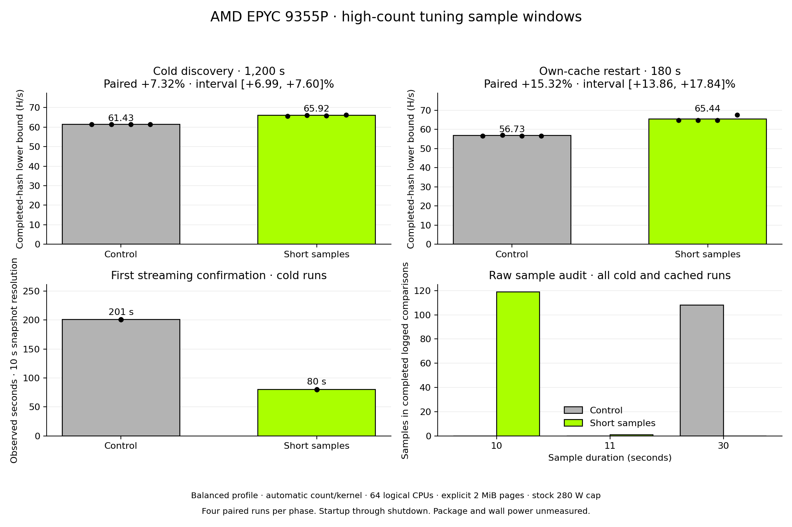

# Turin productive sample-window results

**Accepted on 2026-10-25 after the complete native protocol.** Shorter high-count
kernel trials improved the measured cold and own-cache productive windows on
this EPYC 9355P. The policy is restricted to AuthenticAMD family 1Ah/model 02h,
supported streaming dispatch and the default six-second CPU-autotune setting.
Other identities and explicit timing settings retain their policy.

| Phase | Runs per build | Control H/s | Candidate H/s | Paired geometric change | Descriptive 95% interval |
|---|---:|---:|---:|---:|---:|
| Cold discovery, 1,200 s | 4 | 61.4267 | 65.9207 | +7.3156% | +6.9879 to +7.5982% |
| Own-cache restart, 180 s | 4 | 56.7332 | 65.4372 | +15.3234% | +13.8566 to +17.8387% |

H/s columns divide summed logged completed hashes by summed service-start through
stopped-service elapsed time. Changes use paired geometric ratios, not ratios
of those table aggregates. These are completed-hash lower bounds, not steady-state
peaks. The four within-host pairs and bootstrap intervals describe this session;
they do not establish population-wide performance. Candidate won all four pairs
in each phase. The preregistered cold lower bound above +1% and cached lower
bound at least −2% both passed.



## Hardware and settings

Native Linux on one EPYC 9355P: 32 physical cores, 64 threads, one socket/NUMA
node, 192 GiB across twelve 16 GiB DDR5-4800 DIMMs. Vendor/family/model were
AuthenticAMD/1Ah/02h. Linux was 7.0.0-38-generic. The test used the default
balanced profile, automatic count/kernel selection with all 64 logical CPUs
available, automatic affinity, explicitly provisioned 2 MiB HugeTLB and the
stock 280 W cap. No fixed worker count or kernel override was used in the
productive windows. No OOM, swap or backend quarantine appeared.

**Package, DRAM and wall power were not measured here.** A cap is not measured
watts. The separate manual power/page experiments cannot be multiplied into
these automatic-policy gains. Native Ryzen, multiple NUMA nodes, other profiles,
untouched-host page provisioning and first-upgrade cache migration were not
measured by this experiment.

## What changed and what was observed

Eligible samples may finish after both ten seconds and 256 completed hashes;
otherwise the existing duration/count rule remains. The 2% gain requirement,
duration-dependent quantization margin, 5% drift bound, two confirming A/B/A
cycles, switch acknowledgements, retry/backoff and resource safeguards remain.
The affected kernel-cache configuration gains a policy identifier; count and
kernel search order, startup kernel, affinity, page mode and power cap do not
change in this comparison. The baseline already contains the earlier accepted
Genoa eligibility and Turin ordering changes.

All cold runs started at 32 workers. Controls cached 48, 47, 48 and 48 workers;
candidates cached 64 in all four runs. First streaming confirmation was observed
near 201 seconds for control and 80 seconds for candidate, with ten-second
snapshot resolution. Every cold promotion had two confirmed comparisons.

Each cached restart copied only its own cold-run cache and restored that count.
Control streaming restoration was logged at 36.5–37.0 seconds; candidate at
4.6 seconds. Candidate runs ended with 63, 63, 63 and 64 cached workers, while
control retained its earlier counts. The measured benefit includes those
different trajectories and startup delays; it is not an isolated kernel-speed
or complete-convergence claim. Hashrate sample CVs were 0.0402%/0.3347% for
cold control/candidate and 0.2676%/2.1197% for cached control/candidate.

Three alternating fixed-streaming build-control pairs at 32 workers, with a
20-second warmup and two measured 20-second rounds, changed +0.0737%
(descriptive interval +0.0297 to +0.1464%). No correction was applied to the
productive results.

## Correctness and resource evidence

All 21 full-size reference/dirty-reuse/guard transitions passed. Both measurement
builds used the same experiment-only raw-count logging patch. The audit
recomputed 68 productive decisions, including eight promotions, and all five
resource decisions from exact hashes and durations. Candidate productive logs
contain 120 samples shorter than 30 seconds (10–11 seconds). The resource fixture
also contains three valid 28–29-second samples; its lower-count samples retained
30 seconds. There were no raw/logged decision disagreements.

The complete regular-page, four-CPU resource fixture retained all original
durations: 600 seconds initial operation; 30 seconds each at one/no-arena
budgets; 90 seconds memory recovery; 48 seconds CPU contention; 90 seconds load
recovery; 35 seconds constrained restart; 210 seconds restart recovery; and
35 seconds explicit opt-out. Samples span slightly less than requested intervals
because they are periodic observations; controller timings were not shortened.

Real reclaim added 4,257 memory-high events and 32.257671 seconds of memory PSI.
Workers parked at zero, then recovered. The CPU-load phase added 20,268 μs of
scheduling PSI. A remembered count of three remained three under a one-worker
restart limit. Recovery allocated multiple arenas: three workers with at least
6 GiB anonymous backing were observed during a probe, without claiming final
convergence to three. Explicit opt-out produced hashes without autotuning.
The bounded reclaim helper was supervisor-killed after use (exit −9), not OOM
killed. No OOM/swap/quarantine occurred, and original settings were restored.

## Sources and reproduction

Portable CPU-only Rust 1.93.0, locked release build, no `RUSTFLAGS`:

- Control source: `e517d68edd03ea2baf1e850bb32198cb7d98ecc7`.
- Candidate source: `4cec3919315a5ca23bc040c58f44fbc3400fd86a`.
- Control binary SHA-256: `a33b81c5818568b96adc52a4ec0315fd79fb6197110cb5008a48e81869d38932`.
- Candidate binary SHA-256: `a15046af49bc6a43ce253d5bc806accc7007521dad29d1e1780d9f66b64c521e`.

[Frozen builds](frozen-builds.json), runtime/instrumentation patches and the
[preregistered protocol](README.md) preserve exact provenance. The frozen file's
preparation-time status is historical, not the final outcome. The raw archive is
private because it includes operational inventory and access details.

- Archive SHA-256: `6e82c29721594caf632036e9efb027c9d8a5d6168181c871a3c88b382eb9cfba`.
- Result manifest SHA-256: `27d6f60339a6b3630056fdfb17c4b861529de4bc0e12d65b4d6e90926a98e9d8`.
- Verified manifest entries: **303**. Outcome: **COMPLETE**, restored settings,
  no cleanup failures. Native work finished at **13:40:36 EDT**; collection at
  **13:40:56 EDT**. Provider rental deletion is tracked separately.

The [adoption review](adoption-review.json) binds the exact manifest, binaries,
comparisons, raw decisions and resource evidence. The [analysis](results.json),
[four JSON records](benchmark-records.json), [CSV](benchmark-records.csv),
[PNG](productive.png) and [SVG](productive.svg) are reusable graph inputs.

```sh
/usr/bin/python3 experiments/amd-trial-windows-20261025/analyze.py COLLECTED results.json
/usr/bin/python3 experiments/amd-trial-windows-20261025/export_records.py COLLECTED OUTPUT --review experiments/amd-trial-windows-20261025/adoption-review.json
python3 experiments/amd-trial-windows-20261025/plot.py --data-dir OUTPUT
```

The uninstrumented shipping logic passed 566 CPU-only workspace tests (six
ignored) and 586 AMD-feature workspace tests (nine ignored), at source
`4a8050d9572940ae5c11f072b4602d3805944c5b`, before later offline-audit/report edits
and a policy-comment update. Eighteen Python experiment tests passed, including
saved JSON review round trips and rejection of altered raw samples.

The six ignored CPU cases were `adaptive_kernel_real_arena_smoke`,
`adaptive_real_arena_smoke`, `large_1g_page_mode_reports_measured_1g_backing`,
`pid_budget_startup_probe`, `productive_controller_real_smoke` and
`epyc_streaming_productive_selection`. They require optimized real arenas or
specific page/cgroup fixtures; separately recorded native experiments do not
relabel those exact tests as passes. The three additional ignored AMD cases were
`hip_device_props_parse_sanely`, `hiprtc_kernel_compiles_for_device_arch` and
`gpu_solution_target_bracket_matches_cpu_reference`. No native HIP/GPU result is
claimed.
