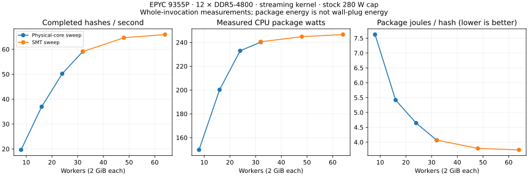
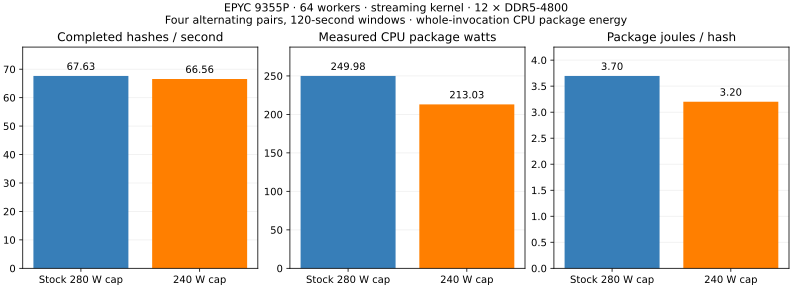

# EPYC 9355P throughput and package-energy results

Measured on 2026-10-25 using the legacy 2 GiB Argon2id workload. The supported
240 W power cap delivered **66.56 H/s at 213.03 W of measured CPU package power**,
retaining **98.42%** of stock-cap throughput with **13.41% less package energy per
hash** in four alternating pairs. This is a fixed-configuration measurement on
one bare-metal host.

## Hardware and measurement

- AMD EPYC 9355P, AuthenticAMD family 26/model 2: 32 cores, 64 hardware threads,
  one socket and one NUMA node.
- Twelve populated channels, each with one 16 GiB DDR5-4800 DIMM; 192 GiB installed.
- Linux 7.0.0-38-generic; streaming kernel `avx512-256-stream`, automatic affinity,
  verified explicit 2 MiB HugeTLB backing. Worker count and kernel were fixed.
- Whole-invocation H/s and package energy include startup, allocation, reported
  hashes, fences and teardown. Separate DRAM and wall-plug energy were not measured.
- Four alternating pairs per comparison, ten seconds of settling. The worker
  sweeps use 60-second windows and the separate power comparison uses 120 seconds.
  Baselines repeated beside several challengers therefore have more observations.
- All 21 full-size reference transitions passed, including dirty arenas and guard
  blocks. Every accepted report passed counter, backing, no-swap and no-OOM checks.

## Stock-cap worker scaling

| Phase | Workers | Invocations | Completed H/s | Package W | Package J/hash |
| --- | ---: | ---: | ---: | ---: | ---: |
| Physical-core sweep | 8 | 4 | 19.64 | 149.73 | 7.622 |
| Physical-core sweep | 16 | 4 | 36.96 | 200.24 | 5.418 |
| Physical-core sweep | 24 | 12 | 50.19 | 232.97 | 4.642 |
| Physical-core sweep | 32 | 4 | 59.10 | 240.24 | 4.065 |
| SMT sweep | 32 | 8 | 59.10 | 240.54 | 4.070 |
| SMT sweep | 48 | 4 | 64.63 | 244.85 | 3.788 |
| SMT sweep | 64 | 4 | 65.92 | 246.63 | 3.741 |

The fresh 64-versus-32 pairs measured +11.54% H/s and -8.12% package J/hash.
These are observed scaling points at a stock 280 W cap. The 48-worker point
retained about 98% of the 64-worker rate using 32 GiB less arena memory.



## Fresh power-cap confirmation at 64 workers

| Configured cap | Invocations | Completed H/s | Measured package W | Package J/hash | Hashes/package J |
| --- | ---: | ---: | ---: | ---: | ---: |
| 280 W | 4 | 67.63 | 249.98 | 3.696 | 0.2705 |
| 240 W | 4 | 66.56 | 213.03 | 3.200 | 0.3125 |

Configured caps are limits, not measured power. The 240 W setting passed the
predeclared gate: all four pairs improved energy/hash; the descriptive 95%
paired interval for J/hash change was **-13.49% to -13.31%**, and throughput
retention exceeded 95% throughout its interval. The throughput change was
**-1.58%** (interval **-1.65% to -1.48%**), and package-power change was **-14.78%**.
These intervals describe within-session repeatability on this host.

The 120-second windows amortize invocation overhead differently from the
60-second scaling runs. Keep the two series separate. None of these results
changes the miner's automatic policy or establishes complete-system watts.
The host's cap, empty HugeTLB pool and unused swap were restored afterward.



## Reusable evidence

- [Graph/table JSON records](benchmark-records.json) and [CSV](benchmark-records.csv):
  nine records, including exact settings, metric scope, repetitions and variability.
  JSON also includes each invocation's hashes, seconds, package joules and raw hashes.
- [Full recomputed analysis](results.json), including paired statistics.
- [Frozen protocol](README.md) and [analysis script](analyze.py).
- Private raw inventory and the complete archive stay in the ignored
  `data/cherry-epyc-energy-20261025/` directory. DIMM serials and host access
  details are excluded from the public exports.

Frozen source: `36f40e6381ddc99d5b97b8cb3b5436b119a335c6`.

Binary SHA-256: `0831080222054ab087cfc0c6253eafa79a4870a5ed4be741f8f6c15db9ff496d`.

Verified archive: **269 files**, SHA-256
`079199397aae52d4a0da9efe2ceabd3f3d3fa46b1ae1b211a211e8f7b492ecde`.

Archive manifest SHA-256: `3c679b6bdd7a0712d982aea1ed60ca65650b5aa7766e2a4bdf02488eefe84497`.

Recompute after collecting the raw directory:

```sh
python3 experiments/cherry-epyc-energy-20261025/analyze.py \
  data/cherry-epyc-energy-20261025/collected \
  experiments/cherry-epyc-energy-20261025 --plot
```
