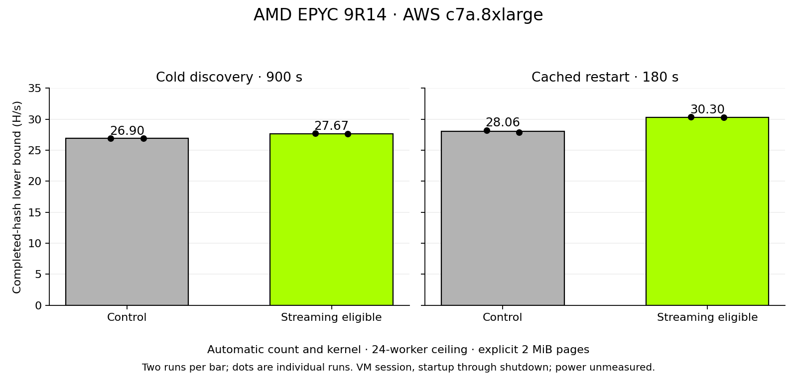

# Genoa automatic streaming trials

**Accepted: try streaming on AuthenticAMD family 19h/model 11h.** The default
starting kernel, runtime instruction checks and two-confirmation adoption rule
remain unchanged. No fixed count or kernel is introduced.

Tested 2026-10-25, 06:07–07:44 EDT: AWS c7a.8xlarge, AMD EPYC 9R14,
32 guest vCPUs, one guest thread/core, 64 GiB allocated RAM, Linux/KVM.
This is a VM allocation, not a complete EPYC socket. Physical channel population
and DIMM speed were not visible. Both sides used explicit 2 MiB HugeTLB,
automatic affinity, the default balanced CPU profile and an automatic worker
ceiling of 24.

| Productive phase | Control H/s | Candidate H/s | Paired gains | Geometric gain |
|---|---:|---:|---|---:|
| Cold discovery, 900 s × 2 | 26.899 | 27.666 | +3.08%, +2.62% | **+2.85%** |
| Own-cache restart, 180 s × 2 | 28.056 | 30.298 | +7.45%, +8.54% | **+7.99%** |

Rates are ratios of total logged completed hashes to total service-start-through-
stopped seconds. Final unlogged hashes are omitted. Startup, ongoing tuning and
shutdown are included. These are descriptive gains from two pairs per phase in
one VM session, not steady-state peaks or population confidence intervals.

Both cold builds started at 12 workers. Both candidate runs confirmed streaming
after two passing A/B/A comparisons there and selected 18 workers. Controls
selected 24 and 23. Every cached restart began at its own previous count;
candidate logs showed streaming restoration during subsequent count exploration
(about 34 seconds into the recorded warm runs). This does not demonstrate
immediate startup restoration or a fully converged worker count. Retaining
streaming after losing challengers at higher counts is not a fresh two-cycle
streaming promotion.

The fixed AVX2 build control at 24 workers was **−0.59%** geometrically
(−0.82%, −0.36%). Automatic results above are unadjusted. All 21 full-size
reference transitions passed, including dirty-arena reuse and guard checks.
All eight productive commands and binary checksums match the frozen protocol.
No swap, OOM or quarantined backend appeared.

Resource validation used ordinary pages separately: workers parked under zero-
arena pressure and resumed afterward. Constrained restart preserved the
remembered count of 3 and recovered from 1 to 2 workers during the observed
210-second recovery phase. Recovery to 3 was not established. CPU contention
and explicit opt-out checks passed. Complete sampled phase counts are in
[results.json](results.json).

Power was not measured. The bare-metal package-efficiency experiment is a
separate dataset and must not be combined with these VM rates to infer H/W.

Measured source/binary identities are in [frozen-builds.json](frozen-builds.json),
with a reconstructable candidate patch. The machine-readable
[adoption review](adoption-review.json) binds the decision to the evidence and
those binaries; it does not claim the later integration build was benchmarked.
The [JSON](benchmark-records.json)/[CSV](benchmark-records.csv) graph records retain
per-run numerators, durations, variability and checksums.

All 156 archived evidence files verified. The rental, root volume and security
group were deleted immediately after collection, at 07:44 EDT. The conservative
duration-based cost estimate is **$2.765**, including IPv4, storage and a transfer
allowance; this is not an AWS invoice. Raw archive and manifest hashes are
recorded in `results.json`; raw operational data remains private.

Integration onto current master passed **562 CPU-only workspace tests** (six
existing hardware/resource tests ignored), nine evidence/export tests and scoped
Rust 1.93 formatting. The measured binary identities above remain unchanged.
